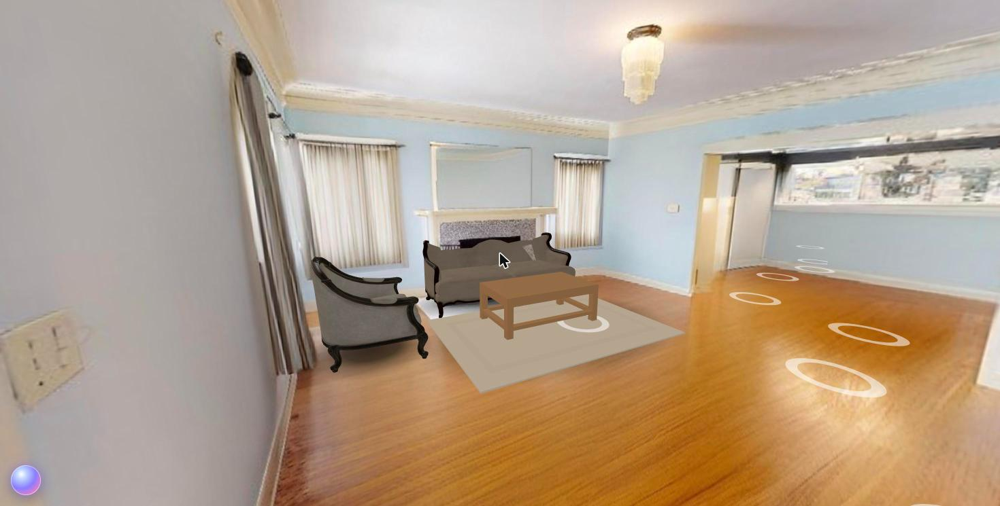

# Walk-In

**Homes.com gets you into the house. Walk-In lets you live in it, and lease the office next door, before you sign.**

Put your phone in a ten-dollar headset and stand inside a real home: a Matterport scan with the furniture digitally
removed, at real size. Furnish it with your bare hands, ask John (the voice assistant) to decorate it, watch the sun
come through the real windows on any day of the year, then walk into an office floor and get a broker's test fit
in thirty seconds. No app: it's a web page.

Built in 36 hours at **HackPrinceton Fall 2026** for the **CoStar Group** track ("Inside and Out: AI for the Built
World"), on CoStar's own data: Matterport digital twins, Homes.com listings and Vexcel aerials.



## What it does

| | |
|---|---|
| **Outside → in** | Opens on the Homes.com listing over the Vexcel aerial, with the roof traced from above, then dives into the empty house. |
| **Walk the real space** | Every scan point's 360° photo, in the house's own coordinates (metres, Z up). Furniture lines up from every viewpoint by geometry, not by guessing. |
| **Bare hands** | MediaPipe tracks both hands from the phone camera (in a worker, off the main thread). Pinch to grab, twist with two hands to turn, push things along walls. Your real hands are cut out of the camera feed and drawn in the scene. |
| **Does it fit?** | The scan's wall graph, doorways and room outlines give a live green/red fit check, doorway clearances and a physics pass (pieces slide along walls and each other). |
| **John, by voice** | Gemini Live with ~40 tools that are the viewer's own functions: *"what would look good in this room?"*, *"decorate it as if I'm a Ronaldo fan"*, *"will a king bed fit in the master?"*, *"paint this wall sage"*, *"undo that"*. He reads rooms, openings and dimensions from the twin. Say "John" once, then just keep talking for 30 s. |
| **Real furniture** | Photoscanned Poly Haven (CC0) and Sketchfab/Objaverse (CC-BY) models at catalogue sizes, with illustrative prices. |
| **Sunlight** | NOAA sun position and true north from the scan: *"show me 6 pm in June"* lights the floor through the real windows and reports how much is in direct sun. |
| **Office test fit** | *"Take me to the office"*, *"seat 50 people"*, *"make them private offices"*, *"add four 8-person meeting rooms on the back wall and a kitchen by the entrance"*. Desks, cabins and zones laid out on the scan, with window access and egress distances spoken. |
| **The scan's own furniture** | The furnished scan's pieces can be lifted out as meshes and moved, with their unseen sides filled in. |
| **Headset mode** | "At eyes": stereo side-by-side for a phone headset, gyro look-around, wake lock, full screen from the Home Screen icon. |

## Run it

```bash
cp .env.example .env              # fill in your own keys (see below); never commit it
python3 prep_house.py zvKHR9DHNjJ # La Mirada house -> data/zvKHR9DHNjJ/  (~30 s)
python3 prep_house.py WhqAmKQ3YYP # the Suite 300 office floor
python3 tools/prep_outside.py zvKHR9DHNjJ   # optional: the listing + aerial opener
python3 serve.py 8000             # http://localhost:8000/?m=zvKHR9DHNjJ
```

**On a phone** (camera and gyro need HTTPS): `cloudflared tunnel --url http://localhost:8000` and open the link
it prints. In Safari, Share → Add to Home Screen gives full screen. The first tap switches to At eyes.

**Keys** (`.env`, read only by `serve.py`; they never reach the browser): `MATTERPORT_API_KEY/TOKEN` for prep,
`VEXCEL_API_KEY` for the opener, `GEMINI_API_KEY` for John (with `OPENROUTER_API_KEY` as the fallback),
`ELEVENLABS_API_KEY` optional (otherwise the browser voice is used).

**No keys?** Everything runs on a synthetic house, offline:

```bash
python3 tools/fake_house.py         # writes data/fixture
GEMINI_MOCK=1 python3 serve.py      # http://localhost:8000/?m=fixture
```

### Useful URL switches
`?eyes=off` (stay handheld) · `?live=off` (typed/turn-based John instead of Gemini Live) · `?captions=off` ·
`?sun=on` · `?handworker=off` · `?feel=off` · `?info` (debug card) · `?debug=1` (walls and calibration keys)

## Tests

```bash
for t in door overlap placement push radial tabletop wallfit walls; do node tools/$t-test.mjs; done
scripts/smoke.sh
```

End to end with the real model: `RELAY_CACHE=0 python3 serve.py 8033`, then open
`http://localhost:8033/tools/e2e.html` for a pass/fail table of every demo step. In the app, standing in a room,
`await walkin.preflight()` checks the house, agent, staging, physics and frame rate.

## How it's built

Plain ES modules, three.js 0.170 from a CDN, no build step. `serve.py` is a small Python server that also relays
Gemini (text, image and Live), OpenRouter and TTS with rate limits and a cache, so keys stay server side.

| File | What |
|---|---|
| `app.js` | Viewer core: pano sphere shader, calibration, navigation, occluders, pointer, headset/stereo, hand interaction |
| `hands.js`, `hands-worker.js`, `realhands.js` | MediaPipe hand tracking in a worker, pinch, the camera cut-out of your real hands |
| `furniture.js`, `realfurniture.js`, `models/` | Catalogue (real sizes), procedural and photoscanned models |
| `physics.js`, `fit.js`, `walls.js`, `placement.js` | Collisions, doorways, fit checks, where new pieces go |
| `agent.js`, `live.js`, `voice.js`, `john-extra.js` | John: tool registry, Gemini Live audio, wake word and captions |
| `suggest.js`, `staging.js`, `styling.js`, `decor.js` | Furnish a room with a price, stage the house, finishing touches, paint/wallpaper/AI art |
| `sun.js`, `lighting.js`, `shade.js` | Sun position, shadows and the sun panel |
| `testfit.js` | Office test fit: desks, private offices, zones, egress |
| `outside.js` | The listing + aerial opener |
| `feel.js`, `radial.js`, `ui.js` | How pieces move and arrive, the pinch ring menu, the dock |
| `prep_house.py`, `tools/` | Data prep (Matterport GraphQL → panos, meshes, plan), mesh tools, tests |

`CLAUDE.md` has the verified notes on the Matterport data and the coordinate frames. `docs/demo-script.md` is the
three-minute demo, `docs/devpost.md` the write-up.

## Data and licences

- `data/` is git-ignored. The Matterport, Homes.com and Vexcel data is licensed to participants for the event
  only; each person downloads it with their own keys.
- Furniture: Kenney (CC0), Poly Haven (CC0), and Sketchfab models via Objaverse (CC-BY 4.0, authors credited in
  `models/CREDITS.md`).
- MediaPipe Tasks (Apache 2.0) is vendored in `vendor/`.

## Team

Amit Jadhav (XR, hands, integration) · Shaurya Beriwala (furniture, physics, test fit, sun) ·
Shruti Srivathsan (John, voice, styling, landing page)
