# Walk-In

**Homes.com gets you into the house. Walk-In lets you live in it, and lease the office next door, before you sign.**

Put your phone in a cardboard headset and stand inside a real home: a Matterport scan with the furniture digitally
removed, at real size. Say what you want and the room changes around you. Furnish it with your bare hands, ask John
(the voice) to decorate it, watch the sun come through the real windows on any day of the year, then walk into an
office floor and get a broker's test fit in thirty seconds. No app: it's a web page.

Built in 36 hours at **HackPrinceton Fall 2026** for the **CoStar Group** track ("Inside and Out: AI for the Built
World"), on CoStar's own data: Matterport digital twins, Homes.com listings and Vexcel aerials.

> The demo build is on the [`v1`](../../tree/v1) branch.

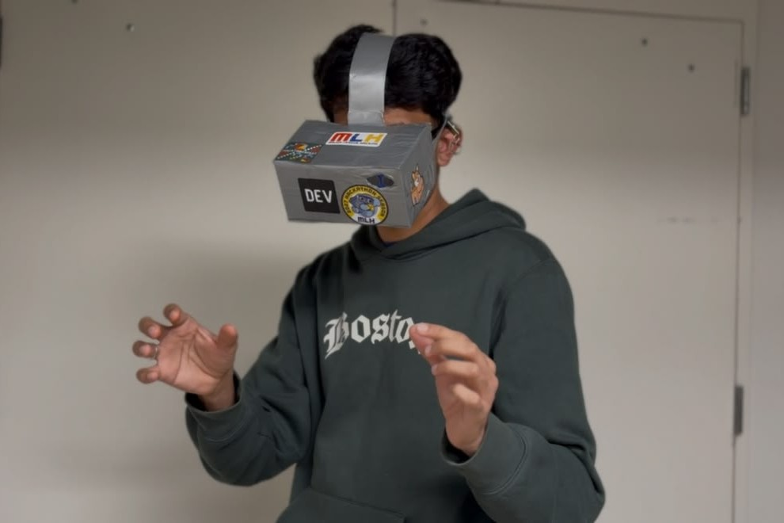

## What it does

| | |
|---|---|
| 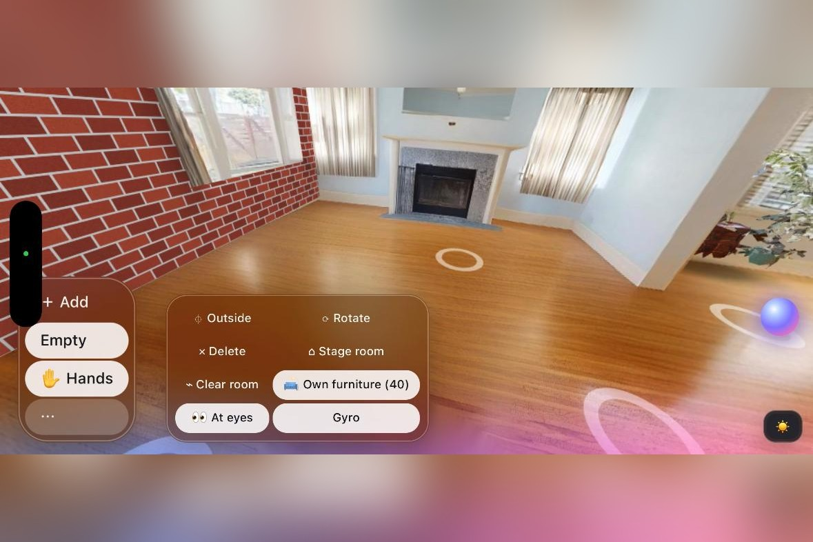 | 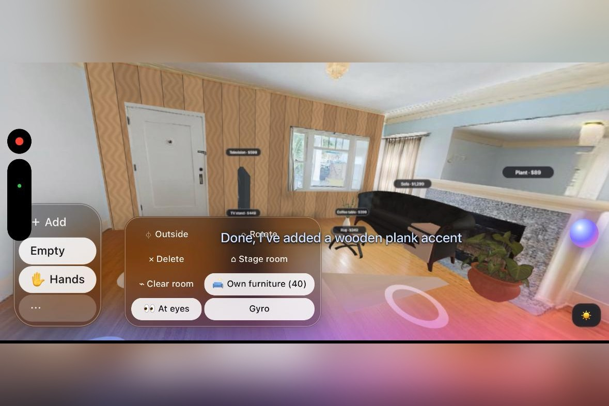 |
| **Say it, and it's there.** "Make this wall brick." "Jungle mural on that one." John makes it from your words and puts it on the actual wall, at real scale, cut around the real doors and windows. | **Let John furnish it, and argue with him.** "What would look good in here?" Pieces land one by one with price tags and the room total overhead. "Cheaper." "Under $1,500?" He re-prices, or drops the plant and the TV and says so. |
| 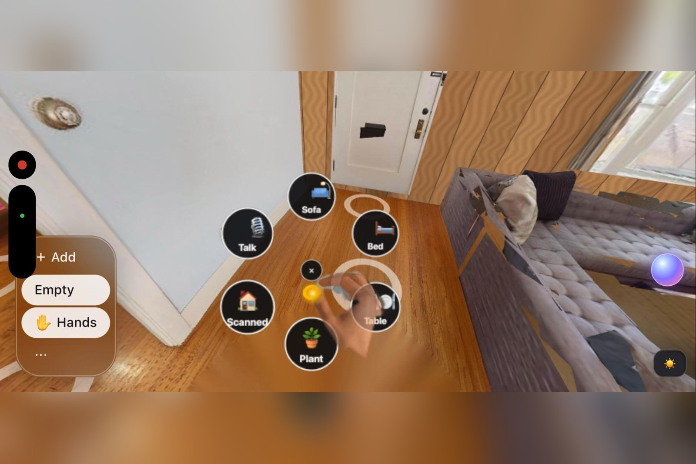 | 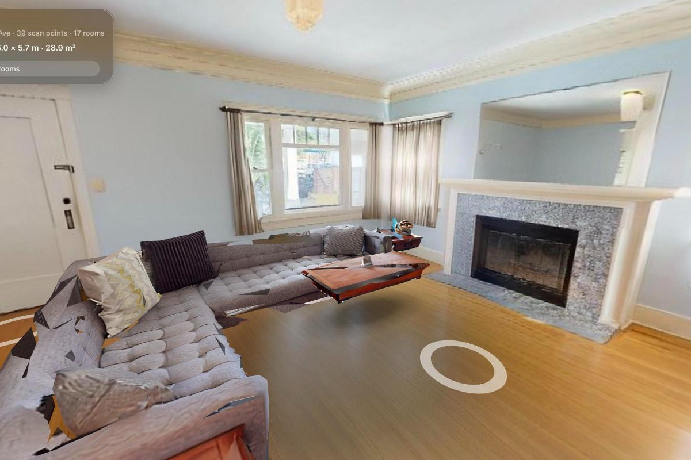 |
| **Reach out and move things.** MediaPipe tracks both hands from the phone camera. Pinch to grab, twist with two hands to turn, push things along walls. Your real hands are cut out of the camera feed and drawn in the scene. | **Keep what you love.** The furnished scan minus the empty one is the home's own furniture, lifted out as real 3D pieces you can slide, turn or remove. The sides the scanner never saw get the piece's own material. |
| 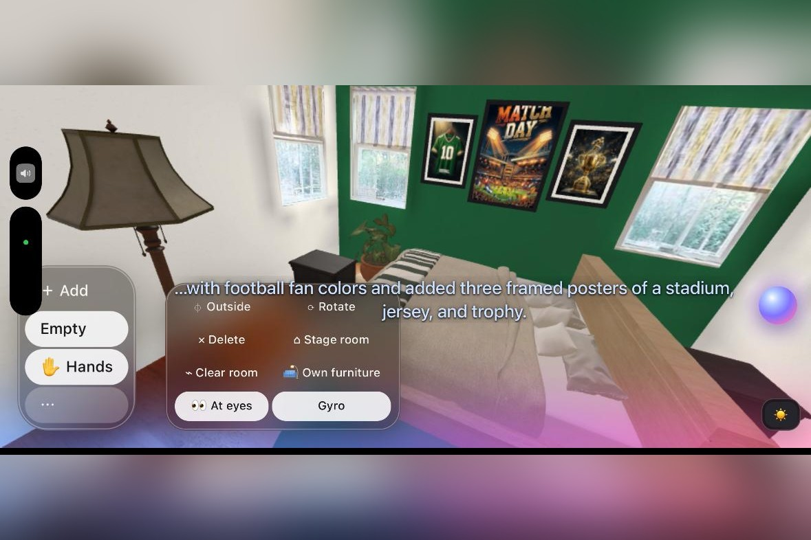 | 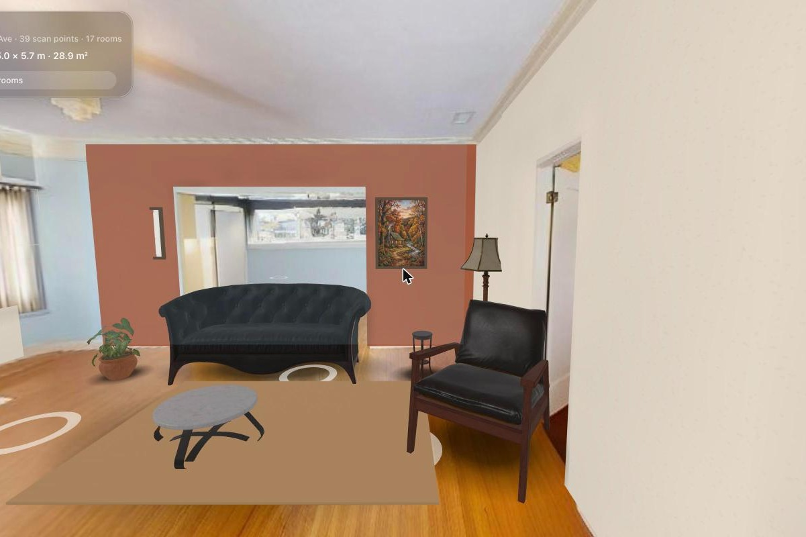 |
| **Any theme you can say.** "Football fan colours": an accent wall and three framed posters, generated and hung on the actual wall. | **A whole room in one sentence.** "Make it cosy": paint, a poster, a rug and a set of furniture, each checked against the room, the doorways and a walkway you can still use. |
| 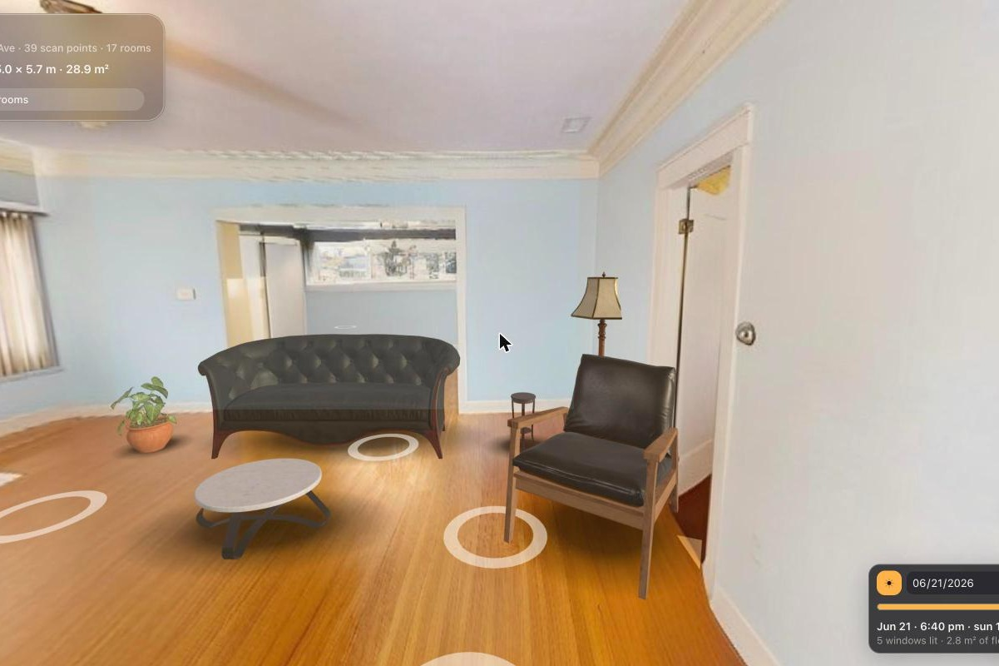 | 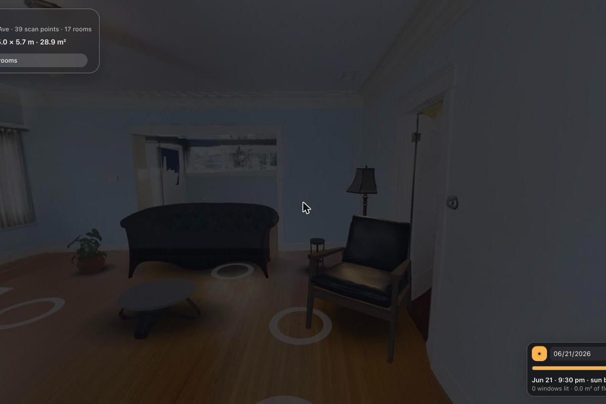 |
| **See it in the light it will have.** NOAA sun position and true north from the scan: the light moves across the floor from the real windows, for the real date. | **And at night.** Windows go dark, lamps come on, screens glow. In the headset you pinch the sun and drag it through the day. |
| 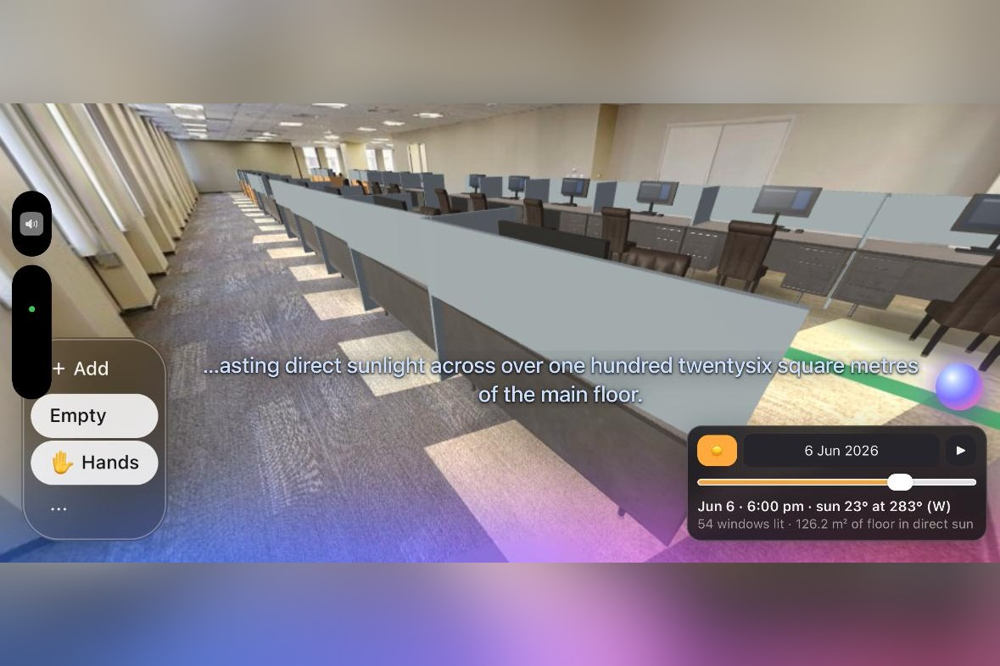 | 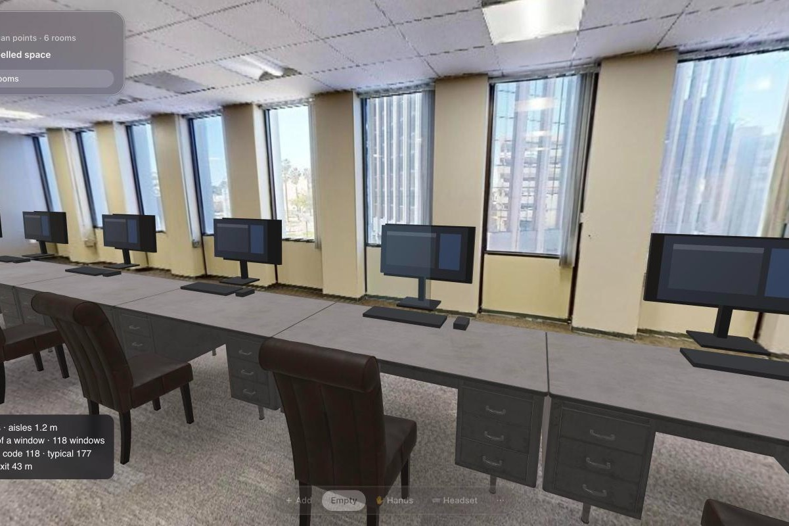 |
| **Not just homes.** Walk into an office floor and ask the same questions: "show me 6 pm in June" lights 126 m² of the main floor through 54 real windows. | **A broker's test fit in thirty seconds.** "Seat 150 people with 1.2 m aisles." Desks lay out across the real floor with window access and egress distance spoken. "Four meeting rooms on the back wall" and they appear. |

<p align="center">
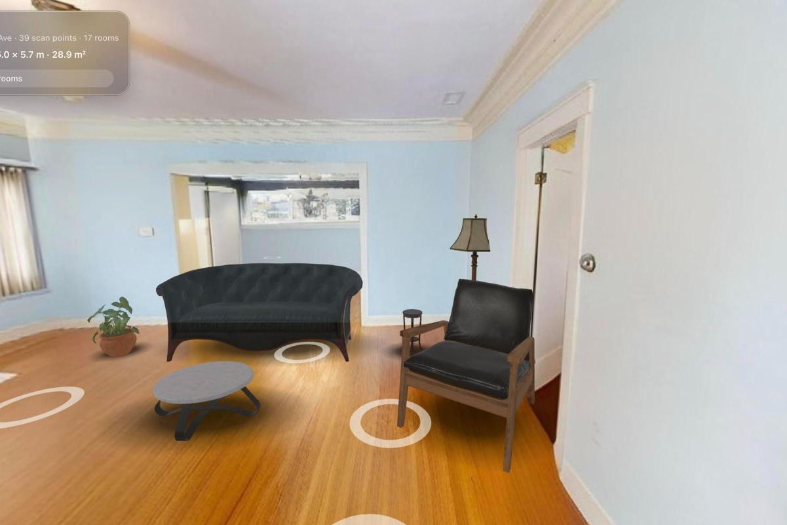
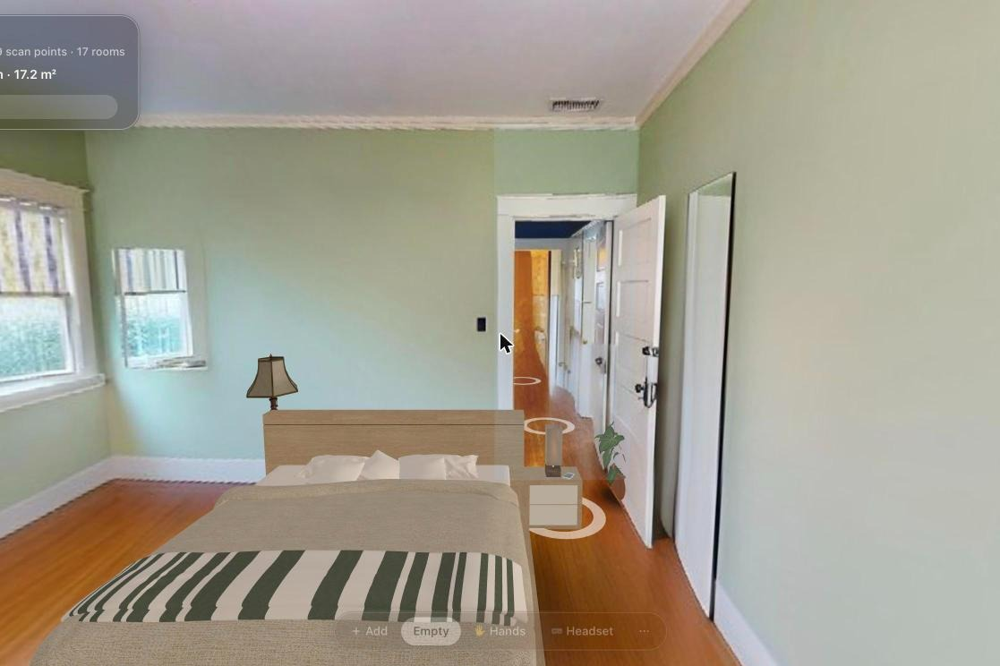
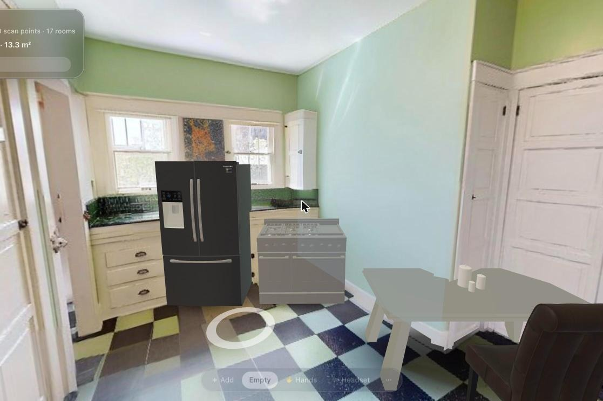
</p>

Everything stays where you put it. Stage a room, walk to the next scan point, look back: not one of the pieces has
moved a millimetre. It lives in the house's own space, in metres, not in a picture.

| | |
|---|---|
| **Outside → in** | Opens on the Homes.com listing over the Vexcel aerial, with the roof traced from above, then dives into the empty house. |
| **Walk the real space** | Every scan point's 360° photo, in the house's own coordinates (metres, Z up). Furniture lines up from every viewpoint by geometry, not by guessing. |
| **Does it fit?** | The scan's wall graph, doorways and room outlines give a live green/red fit check, doorway clearances ("the sofa is 2.10 m across the way you're holding it and that door is 1.15 m") and a physics pass. 19 of this home's 22 doorways are too narrow for a sofa even turned. |
| **John, by voice** | Gemini Live with ~40 tools that are the viewer's own functions. He reads rooms, openings and dimensions from the twin, and when you say "this wall" he sees what you see. Say "John" once, then just keep talking for 30 s. |
| **Real furniture** | Photoscanned Poly Haven (CC0) and Sketchfab/Objaverse (CC-BY) models at real sizes, lit by an environment built from the photo of the room they stand in. |
| **Headset mode** | "At eyes": stereo side-by-side for a phone headset, gyro look-around, wake lock, full screen from the Home Screen icon. iPhone Safari has no WebXR, so the stereo view and head tracking are ours. |

## Run it

```bash
git checkout v1
cp .env.example .env              # fill in your own keys (see below); never commit it
python3 prep_house.py zvKHR9DHNjJ # La Mirada house -> data/zvKHR9DHNjJ/  (~30 s)
python3 prep_house.py WhqAmKQ3YYP # the Suite 300 office floor
python3 tools/prep_outside.py zvKHR9DHNjJ   # optional: the listing + aerial opener
python3 serve.py 8000             # http://localhost:8000/?m=zvKHR9DHNjJ
```

The home's own furniture, per house: `python3 tools/meshdiff.py export <model>`, then `tools/superres.py`,
`tools/meshsharp.py` and (optional, needs a billed Gemini key) `tools/capskin.py`.

**On a phone** (camera and gyro need HTTPS): `cloudflared tunnel --url http://localhost:8000` and open the link
it prints. In Safari, Share → Add to Home Screen gives full screen. The first tap switches to At eyes.

**Keys** (`.env`, read only by `serve.py`; they never reach the browser): `MATTERPORT_API_KEY/TOKEN` for prep,
`VEXCEL_API_KEY` for the opener, `GEMINI_API_KEY` for John (with `OPENROUTER_API_KEY` as the fallback),
`ELEVENLABS_API_KEY` optional (otherwise the browser voice is used).

**No keys?** Everything runs on a synthetic house, offline:

```bash
python3 tools/fake_house.py         # writes data/fixture
GEMINI_MOCK=1 python3 serve.py      # http://localhost:8000/?m=fixture
```

### Useful URL switches
`?eyes=off` (stay handheld) · `?live=off` (typed/turn-based John instead of Gemini Live) · `?captions=off` ·
`?sun=on` · `?mesh=1` (the home's own furniture) · `?handworker=off` · `?feel=off` · `?info` (debug card) ·
`?debug=1` (walls and calibration keys)

## Tests

```bash
for t in door overlap placement push radial tabletop wallfit walls; do node tools/$t-test.mjs; done
scripts/smoke.sh
```

End to end with the real model: `RELAY_CACHE=0 python3 serve.py 8033`, then open
`http://localhost:8033/tools/e2e.html` for a pass/fail table of every demo step. In the app, standing in a room,
`await walkin.preflight()` checks the house, agent, staging, physics and frame rate.

## How it's built

Plain ES modules, three.js 0.170 vendored, no build step. `serve.py` is a small Python server that also relays
Gemini (text, image and Live), OpenRouter and TTS with rate limits and a cache, so keys stay server side. The
libraries are bundled, so it runs without the venue Wi-Fi.

| File | What |
|---|---|
| `app.js` | Viewer core: pano sphere shader, calibration, navigation, occluders, pointer, headset/stereo, hand interaction |
| `hands.js`, `hands-worker.js`, `realhands.js` | MediaPipe hand tracking in a worker, pinch, the camera cut-out of your real hands |
| `furniture.js`, `realfurniture.js`, `models/` | Catalogue (real sizes), photoscanned models, the home's own furniture |
| `physics.js`, `fit.js`, `walls.js`, `placement.js` | Collisions, doorways, fit checks, where new pieces go |
| `agent.js`, `live.js`, `voice.js`, `john-extra.js` | John: tool registry, Gemini Live audio, wake word and captions |
| `suggest.js`, `staging.js`, `styling.js`, `decor.js` | Furnish a room with a price, stage the house, finishing touches, paint/wallpaper/AI art |
| `sun.js`, `lighting.js`, `shade.js` | Sun position, shadows and the sun panel |
| `testfit.js` | Office test fit: desks, private offices, zones, egress |
| `outside.js` | The listing + aerial opener |
| `feel.js`, `radial.js`, `ui.js` | How pieces move and arrive, the pinch ring menu, the dock |
| `prep_house.py`, `tools/` | Data prep (Matterport GraphQL → panos, meshes, plan), mesh tools (`meshdiff`, `meshsharp`, `superres`, `capskin`), tests |

`CLAUDE.md` has the verified notes on the Matterport data and the coordinate frames. `docs/demo-script.md` is the
three-minute demo, `docs/devpost.md` the write-up.

## Things we found out the hard way

- Every scan point has its own rotation, and the photos, the image mapping and the model each use a different set
  of axes. One wrong sign and the furniture slides across the floor as you turn your head. We knew the calibration
  was right when the wood floor in the photo stopped exactly on the wall graph.
- The API gives latitude, longitude and a rotation, and nothing says which way the quaternion points. We checked
  true north against OpenStreetMap: three degrees apart.
- Room polygons on commercial scans are unreliable (Suite 300's main room came back as 20 m²; it's 1,461), so the
  test fit rasterises the floor from the mesh instead.
- Photogrammetry closes every scan hole with a slab; a dining table had 120 of them. Cap only a missing side, close
  small holes on their own rim texture, and give the unseen sides the weave of the seen ones.
- We had no VR headset. A phone, cardboard, two lenses and tape turned out to be the right constraint: CoStar's
  customers don't own VR hardware either.

## Data and licences

- `data/` is git-ignored. The Matterport, Homes.com and Vexcel data is licensed to participants for the event
  only; each person downloads it with their own keys.
- Furniture: Kenney (CC0), Poly Haven (CC0), and Sketchfab models via Objaverse (CC-BY 4.0, authors credited in
  `models/CREDITS.md`).
- MediaPipe Tasks (Apache 2.0) is vendored in `vendor/`.

## Team

Amit Jadhav (XR, hands, integration) · Shaurya Beriwala (furniture, physics, test fit, sun) ·
Shruti Srivathsan (John, voice, styling, landing page)
